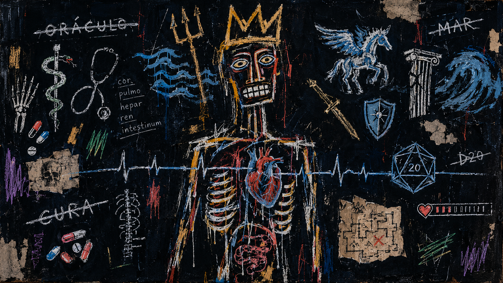
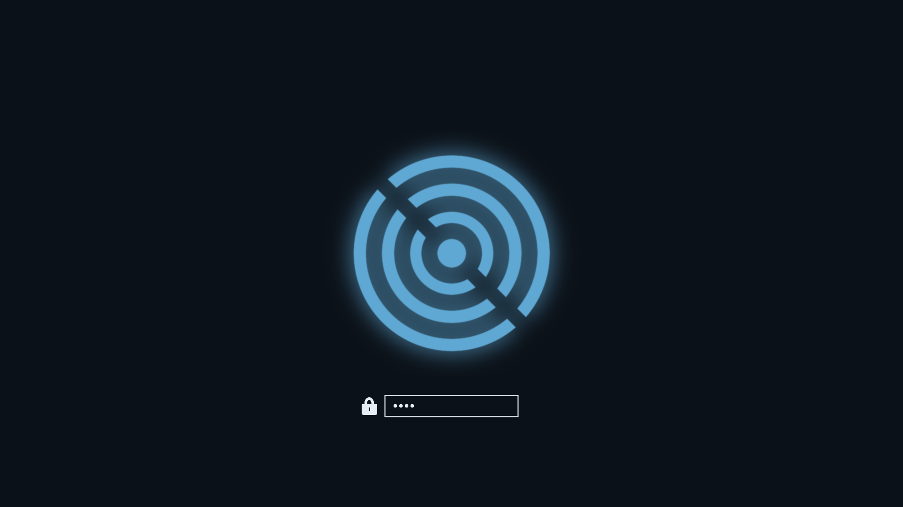

# Oráculo for Omarchy

[](https://github.com/PedroAugustoOK/omarchy-oraculo-theme/actions/workflows/ci.yml)

Blue-black surfaces, cool text and a steel-blue accent. A dark theme built around `colors.toml` and Omarchy's application templates.



Original neo-expressionist artwork inspired by Jean-Michel Basquiat, with medical, maritime and RPG motifs. This is theme artwork; desktop captures are still to be added.

## Install and use

```bash
omarchy theme install https://github.com/PedroAugustoOK/omarchy-oraculo-theme
omarchy theme set oraculo
omarchy theme bg next
```

The installer applies the theme immediately. To use the sibling variant, install
[light Oráculo](https://github.com/PedroAugustoOK/omarchy-oraculo-light-theme).

```bash
omarchy theme update
omarchy theme refresh
omarchy theme remove oraculo
```

`update` updates installed themes; `refresh` reapplies the active one. Remove this
theme after switching to another. Keyboard shortcuts can vary between Omarchy versions.

## Palette and compatibility

The palette covers surfaces, text, selections, ANSI hues and Hyprland borders.
Terminals, editors and the shell follow the templates provided by the installed
Omarchy version. Requires Omarchy 4.x with the `colors.toml` theme system and
Hyprland gradient support. Application coverage depends on that version.

[Measured palette and contrast](docs/PALETTE.md) lists the current values. Text
roles, including muted text, meet 4.5:1 on the four opaque palette surfaces;
ANSI hues meet 4.5:1 on the terminal background. Selected text is checked using
both `foreground` and Omarchy's derived `bright_foreground`. These measurements
do not certify every application, opacity setting or syntax-highlighted selection.

## Included artwork

Three static wallpapers are included in `backgrounds/`. Cycle through them with
`omarchy theme bg next`. `preview.png` is the theme-picker artwork.



`unlock.png` is transparent boot/unlock artwork; `preview-unlock.png` illustrates
it against the theme background. It is a generated illustration, not a capture
of a running login screen. Appearance settings control activation of unlock art.

## Development and credits

- [Development, checks and limitations](docs/DEVELOPMENT.md)
- [Change log](CHANGELOG.md)
- [Historical research](docs/RESEARCH.md)

Theme palette and included artwork: PedroAugustoOK. Wallpapers and unlock assets
were produced with ImageMagick; the Oráculo preview artwork was generated
separately. Original assets are distributed under [MIT](LICENSE), alongside the
palette and tooling. Yaru icon names refer to the separately installed Yaru icons.

Built for [Omarchy](https://omarchy.org/manual/making-your-own-theme/).
